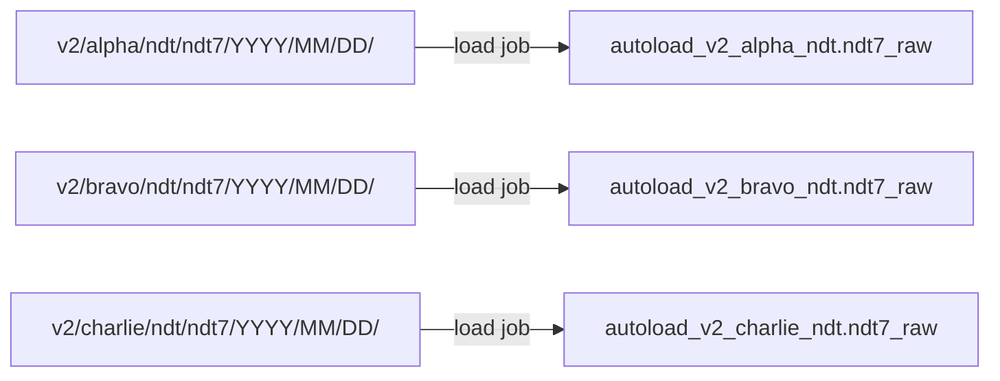
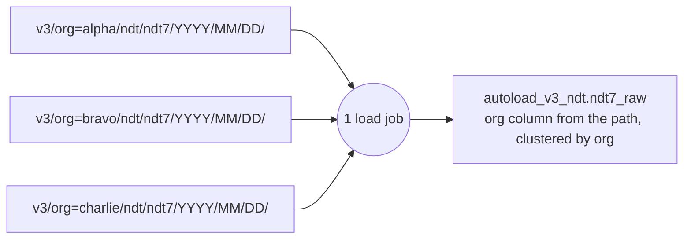
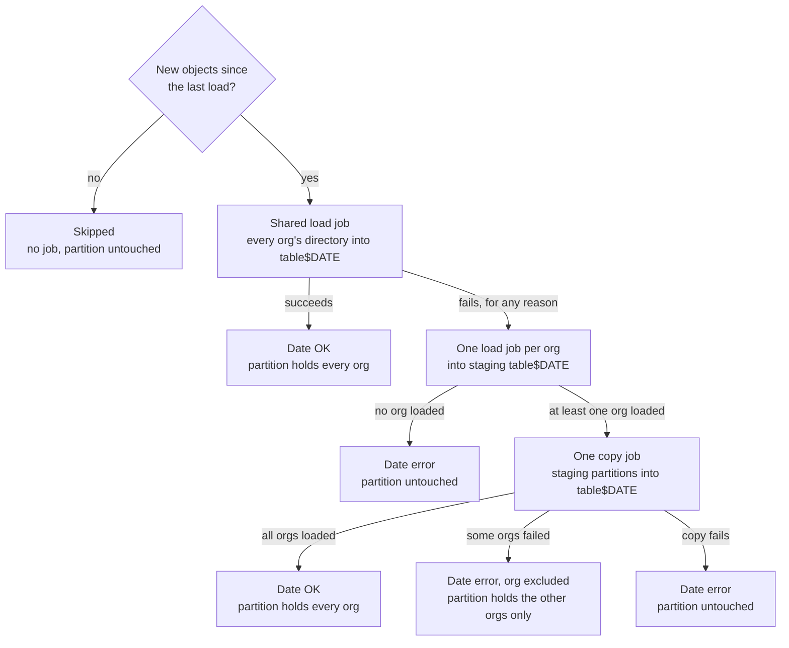

# Autoloader v3 design

v3 loads every organization's results for a datatype into one BigQuery table, with the organization as a column taken from the object path. In v2, each organization has its own dataset and tables.

The aim is fewer load jobs and tables that can be queried across organizations without a generated view per organization. v1 and v2 keep running unchanged next to v3.

## Layout

| | Path or name |
|---|---|
| Objects | `autoload/v3/org=<name>/<experiment>/<datatype>/YYYY/MM/DD/<file>.jsonl.gz` |
| Schema files | `autoload/v3/tables/<experiment>/<datatype>.table.json` |
| Destination | dataset `autoload_v3_<experiment>`, table `<datatype>_raw` |
| Staging | dataset `autoload_v3_<experiment>_staging`, table `<datatype>_<org>` |

- A datatype exists because a schema file exists. The file has no `org` column; the autoloader adds it, and rejects a schema file that defines one. Schema files are uploaded by hand.
- Tables are partitioned by day on `date`, as in v1 and v2, and clustered by `org`, so a query that filters on one organization reads only that organization's blocks.
- The `org=<name>` path component becomes the `org` column through a hive-partitioned load. A row cannot set its own `org`.

## What changes from v2

For one datatype and one date, v2 runs one load job per organization, each into that organization's own table:

v3 runs one load job that names every organization's directory:

In v2 the number of load jobs and tables grows with the number of organizations. In v3 it does not. Each job replaces one day partition, so loading a date twice never duplicates rows.

## What happens to one date in a run

One organization's bad file must not block the others. If the shared job fails for any reason, the date is loaded again one organization at a time into staging tables, and the organizations that loaded are combined with a copy job.

The "org excluded" outcome is the trade-off to know about. An organization whose data cannot be loaded has no rows for that datatype and date afterwards, including rows that an earlier run had loaded. The other organizations are unaffected, the run responds with an error, and `autoloader_excluded_orgs_total{version, experiment, datatype, org}` counts the organization.

- There is no retry and no classification of errors. A transient backend error on the shared job takes the same path as a corrupt file.
- One kind of failure, a row whose `date` does not match the destination partition, names neither the file nor the organization. That is why the fallback isolates by organization and does not parse the error.
- Staging tables expire after 48 hours and have the destination's partitioning and clustering, which a copy job requires.
- A failed date does not stop later dates in the same run.
- If the request is cancelled during the fallback, nothing is copied and no organization counts as excluded.

## When a date is loaded

v1 and v2 reload every date in the run's window, changed or not. v3 loads a date only when something new has arrived for it. Nothing is stored for this: the day partition's own last-modified time is the record of the last load.

A run loads a date when any of these holds:

- its partition has zero rows;
- its newest object was created after the partition's last load, minus a margin of 6 hours;
- the partition's metadata cannot be read;
- the request names explicit `start` and `end` dates.

The last case is how an operator forces a reload, for example after removing a bad object, which change detection cannot see.

The margin exists for an object that arrives while a load of its date is running. Without it, that object would be older than the partition's new last-modified time and would never be picked up. The cost is about two extra loads per date.

Example for one date, with runs every 3 hours, the last regular object created at 02:00 and a late file at 16:30:

| Run | Last load | Margin reaches back to | Newest object | Result |
|---|---|---|---|---|
| 03:00 | 00:00 | 18:00 (previous day) | 02:00 | loaded |
| 06:00 | 03:00 | 21:00 (previous day) | 02:00 | loaded |
| 09:00 | 06:00 | 00:00 | 02:00 | loaded |
| 12:00 | 09:00 | 03:00 | 02:00 | skipped |
| 15:00 | 09:00 | 03:00 | 02:00 | skipped |
| 18:00 | 09:00 | 03:00 | 16:30 | loaded |
| 21:00 | 18:00 | 12:00 | 16:30 | loaded |
| 24:00 | 21:00 | 15:00 | 16:30 | loaded |
| 03:00 | 24:00 | 18:00 | 16:30 | skipped |

The comparison uses each object's creation time, not its update time, because storage-class changes move the update time.

## Decisions and known limits

| Topic | What was decided | Consequence |
|---|---|---|
| Excluded organization | The copy still runs and the date is reported as an error. | That organization loses the day until the date is reloaded. For today and yesterday the next run does it. An older date needs a forced reload. |
| Retries | None, for the shared job or the staging loads. | A transient error costs one staging load per organization for that date. |
| Schema updates | The v3 table schema is updated on every run. | A schema file uploaded while a run is in progress is no longer missed. A new column lands after `org`, so `org` is the last column only at creation. |
| Fallback size | One copy job combines the organizations. | A copy job takes at most 1,200 source tables. Beyond that many organizations on one date, a bad file blocks the date for everyone again. |
| Shared job size | One load job names one directory per organization. | A load job takes at most 10,000 source URIs. |
| Buckets | The table name has no bucket in it. | If two buckets hold the same experiment and datatype, only the first is loaded and the other is logged as skipped. |
| Alerting | Existing metrics gain a `version` label. | The existing alert only watches the daily run. An alert on the excluded-orgs counter is needed to see an exclusion in the weekly or monthly run. |

## Not in this design

- Views over the v3 tables, and a union with the v2 per-organization views (m-lab/etl-schema).
- Carrying an excluded organization's existing rows over into the new partition.
- Loading the rest of an organization's day when only some of its files are bad.
- Parallel load jobs, and change detection for v1 and v2.
